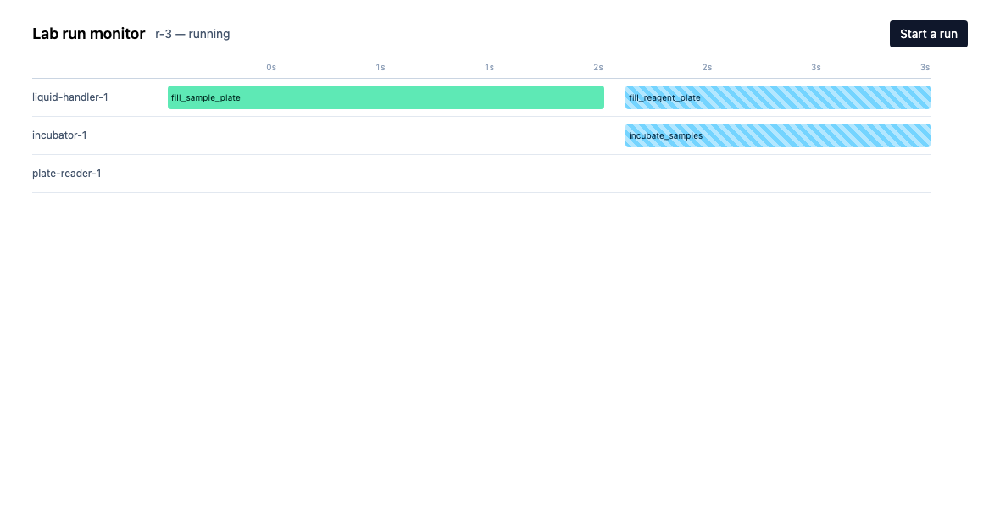
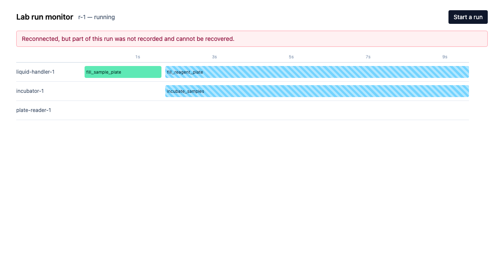

# Lab run monitor

## Context

This is a slice of a lab automation platform: software that drives robotic lab
equipment through scientific workflows, and shows a scientist what is happening.

- **A run** is a DAG of steps. Each step needs one device, and each device does
  **one thing at a time**.
- **The simulator** stands in for the lab. It plays a run and reports what
  happens over a WebSocket.
- **The browser** shows a timeline: one lane per device. It is a record of what
  the instruments actually did, not just where the run has got to.

The default workflow:

```
fill_sample_plate --+--> incubate_samples ----------------------+
                    |                                           |
                    +--> fill_reagent_plate --> warm_reagent ---+--> combine --> read_plate
                    |                                           |
                    +--> fill_buffer_plate ---------------------+
```

Three steps share the liquid handler and two share the incubator, so a device is
sometimes asked for while it is busy. That is normal, and it is reported.

## Architecture

```
   browser (React + TS)                    simulator (Python)
   +---------------------+                 +-----------------------+
   | timeline (provided) |                 |  run engine (provided)|
   | runState.ts  <- you |                 |  stream.py   <- you   |
   +----------+----------+                 |  retry.py    <- you   |
              |                            +-----------+-----------+
              |   GET /runs/{id}     snapshot           |
              +<------------------------------------->  |
              |   ws /ws?resume_from=N   events         |
              +<------------------------------------->  +
```

## The problem

**The event stream is not resumable.**

Every event arrives with `seq: 0`. The field is on the wire; nothing assigns
it. The server keeps no history either — it writes to whoever is connected at
that instant, and once written an event is gone.

So a browser that loses its connection for ten seconds loses ten seconds of the
run permanently — and cannot tell that it did. It reconnects and picks up
whatever comes next. Steps that started and finished inside the gap never
appear at all; a failure and its retry are simply missing. It looks correct. It
is not.

With every event numbered `0` it also cannot tell a duplicate from a new event,
or notice that two arrived in the wrong order.

Your job is to fix that, end to end.

## What it looks like when it works

The timeline is **provided and styled** and problem 1 needs no visual work at
all. The one piece of screen you design is the failure surface in problem 2.
These are from the reference implementation so you know what you are aiming at.

Mid-run. One lane per instrument, one bar per attempt. Striped bars are running;
solid green have finished. A running bar is drawn up to the current time and
carries **no end** — the instrument has not reported one.



The same screen after the connection has been away long enough to miss
something. The banner is `<Banner>`, provided and styled; making
`selectConnection` report anything other than `live` is task 4. Note the two
bars still striped as running: their `finished` events fell in the gap, so the
screen does not claim to know they ended.



## Getting started

Prerequisites: Docker, Node 22 with `pnpm` 11, and Python 3.12 with `uv`.

The simulator runs in Docker; the web app runs on your machine.

```bash
docker compose up --build -d          # simulator on :5002

cd ../web
pnpm install
pnpm exec playwright install chromium  # for the browser checks
pnpm dev                               # http://localhost:3000
```

Open http://localhost:3000 and press **Start a run**. A clean run takes about
14 seconds.

The timeline is blank until you build the state layer. That is expected.

---

# The exercise

Guide timeframe should be around two to four hours, but spend as much or as
little as you like — just tell us roughly how long you actually spent. We are
not scoring speed, and knowing the time is what lets us read everything else
fairly.

There are **two problems and a note**. Make time for at least a basic pass at
both problems: the first shows us how you solve a fullstack problem, and the
second shows us how you make decisions for a user. Both demonstrations are
important. Neither has to be finished if the timeframe does not allow it.

The note is different: it is **required**, and a submission without a `NOTES.md`
is incomplete. Stop with time left to write it.

Note: problem 2 needs rungs 1 and 2 — a failure cannot reach the screen until
events are numbered and folded — but it does not need rungs 3 and 4. If time
runs short, drop those, say so in the note, and move on. Problem 2 is almost
entirely ungated, so do not measure your progress in green ticks, but against
the user-facing surface that you create.

You are welcome to use AI assistance. We will ask you to walk us through your
reasoning and your choices, so work in a way that lets you do that. If you can
share your Claude or Codex conversations, that would be ideal.

---

## Problem 1 — make the run honest

_The screen must never claim to know something it does not._

Three files, one problem. Build it in this order — each rung is worth having
before you start the next.

1. **Number the events.** Every event carries a monotonic `seq`, and a snapshot
   says where it sits in the stream.
2. **Fold them into the screen.** Late, duplicated and out-of-order delivery all
   land on the same result.
3. **Survive a reconnect.** A client resumes from where it left off and loses
   nothing.
4. **Admit an incomplete record.** When the gap cannot be served, the person
   looking at the screen finds out.

Those four are what we check. Going further is your call — if you do, or if you
decide not to, the note is where you tell us.

### `simulator/stream.py` — make the stream resumable

Give every event a **monotonic sequence number**, keep the recent past in a
**bounded buffer**, and serve `subscribe(resume_from)` from it before going live.
Report `gap` when the caller asks for a position you no longer hold, and
return a real `watermark()` so a snapshot can say where it sits in the stream —
`GET /runs/{id}` already puts it in the response as `seq`.

Do this first. The state layer has nothing to order until events are numbered.

### `web/src/lib/runState.ts` — fold it into what the screen shows

Everything on screen comes from here. Events can arrive **late, twice, or out
of order**, and the result must not depend on which. Steps can be retried, so
the same step can run more than once. A step that has started and not finished
has **no end time** — do not give it one. Use the snapshot's `seq` so you can
tell which events it already covers.

Plain TypeScript, no React, so the tests call straight in.

### `simulator/api.py` + the connection state — say when the record is incomplete

When a client asks to resume from a position the buffer no longer holds, some of
the run happened and nobody can replay it. Sending nothing is the same as
pretending it did not.

Decide what the client is told — the shape is yours, see the `TASK` comment —
make sure it can tell this apart from a clean resume, and make sure **the person
looking at the screen finds out**. `<Banner>` is provided and renders whatever
`selectConnection` reports.

```bash
uv run pytest
cd web && pnpm test
./scripts/acceptance.sh
./scripts/check-disconnect.sh
```

---

## Problem 2 — make a failure actionable

_Something went wrong. Two people need to do something about it: a scientist
standing at the bench, and an integrator's script._

This half is deliberately unspecified. There is no right answer and almost
nothing is graded — we will read it and ask you why.

### `simulator/retry.py` — the endpoint

A failed step can be run again. `claim_retry` is written for you; the HTTP
surface is not.

Nobody has specified it: status codes, response body, what a second identical
call does, what a caller is told when the step cannot be retried. The route is
wired in `api.py` and the browser calls it through `web/src/lib/api.ts` —
change either if your design wants a different shape.

### The failure surface — what a scientist sees, and what they can do

When a step fails, its bar stops and turns red — and that is all the feedback
the user currently gets: no reason, no detail, no way to react. Determine what
this should look like, how it should work, and create an implementation. Make
changes that create an effective user experience that will allow the user to
understand failures and react to them appropriately.

Decisions you will meet on the way:

- **Where failures live.** A panel? The bar itself? A detail view? The page is
  yours to extend.
- **Which failures are actionable.** A step that failed and was retried has two
  attempts on the record. Is the failure still something to act on?
- **What the screen claims between the click and the stream.** Nothing confirms
  a retry except the events that follow.
- **What the endpoint's response means on screen.** You designed both sides of
  that conversation.
- **`context` is different for every instrument and every fault.** The incubator
  reports temperatures and door cycles; the liquid handler reports channels and
  tip boxes; the plate reader reports calibration dates. Nothing enumerates the
  keys, and new instruments arrive without asking you first.
- **`retryable` is sometimes false.** A plate reader whose calibration expired
  will fail the same way however many times you ask it. What does the screen
  offer instead of a button?

```bash
FAIL_STEP=warm_reagent_plate docker compose up -d simulator   # incubator
FAIL_STEP=read_plate         docker compose up -d simulator   # not retryable
FAIL_STEP=fill_buffer_plate  docker compose up -d simulator   # liquid handler
```

Tailwind is set up and there are styled primitives in `components/`. We are not
scoring how it looks — we are scoring what you chose to show and what you chose
to hide.

---

## The note — required

**Do not skip this, and do not leave it to the last five minutes.** A submission
without a `NOTES.md` is incomplete. We read the note beside the code and **we
spend a good part of the interview on it** — it is where you tell us what you
chose not to build, and why, which the code cannot say for you.

Add a `NOTES.md` and commit it with your code. Start with roughly how long you
spent, then around 400 words:

1. What did you deliberately **not** build, and why?
2. Where is your state layer most likely to break?
3. An event arrives for a step you have never seen. What does your code do?
4. An integrator is going to build against the event contract in
   `simulator/events.py` and against the endpoint you just designed. What would
   you change before they did, and what would you leave alone?

Bullets are fine. No diagrams, and please do not spend time on formatting — we
are reading it for the reasoning.

### Then tell us what you thought of the exercise

Finish the note with a short section — a few bullets is plenty — about the
technical challenge itself:

- Was the brief clear? What did you have to guess at?
- How long did it really take, against the two to four hours we suggested?
- What was worth your time, and what was not?
- Did anything get in the way — setup, tooling, the checks, unclear scope?
- What would you change?

We are genuinely interested in what you thought, so be blunt. We read this part
like the rest of the note: a clear critique of the exercise tells us how you
think. Criticising it will not count against you.

## Checking your work

|                                 | What it covers                                 |
| ------------------------------- | ---------------------------------------------- |
| `uv run pytest`                 | The stream, and that the endpoint works at all |
| `cd web && pnpm test`           | The state layer                                |
| `./scripts/acceptance.sh`       | The timeline during a clean run                |
| `./scripts/check-disconnect.sh` | A dropped connection                           |
| `cd web && pnpm check`          | eslint + prettier. `pnpm format` fixes both    |

**Problem 2 is almost entirely ungated.** That is deliberate — ungated does
not mean optional. It is where we look first.

Everything except the engine tests fails on the starter. That is the point.

## Making the lab misbehave

Set these in your shell; all are off by default. The percentages take a whole
number from 0 to 100. `GET /health` reports what everything is currently set
to, and the check scripts warn you when one is on.

| Knob                           | Effect                                               |
| ------------------------------ | ---------------------------------------------------- |
| `FAIL_STEP=warm_reagent_plate` | That step fails once, on its first attempt           |
| `REORDER_PCT=30`               | Events are delivered out of order                    |
| `DUPLICATE_PCT=20`             | Events are delivered twice                           |
| `SOCKET_KILL_MS=4000`          | The server drops every socket on a timer             |
| `SOCKET_REJECT_MS=6000`        | After a drop, the server stays unreachable this long |
| `REPLAY_BUFFER_SIZE=8`         | A small buffer, so a reconnect can miss the window   |

```bash
FAIL_STEP=warm_reagent_plate docker compose up -d simulator
REORDER_PCT=30 DUPLICATE_PCT=20 docker compose up -d simulator
docker compose up -d simulator     # back to normal
```

**To reach an unservable resume you need all three.** A dropped socket reconnects in about
250ms, which is not long enough for the buffer to move past you, so a small
buffer on its own will never produce an unservable resume:

```bash
SOCKET_KILL_MS=2500 SOCKET_REJECT_MS=6000 REPLAY_BUFFER_SIZE=2 \
  docker compose up -d simulator
```

`REORDER_PCT` and `DUPLICATE_PCT` are applied on the wire, after sequence
numbers are assigned. They model a network, not a bug in anyone's code.

## What is provided

You should not need to change these, though you may.

|                                      |                                                             |
| ------------------------------------ | ----------------------------------------------------------- |
| `simulator/engine.py`                | The run engine: dependencies, device contention, failures   |
| `simulator/api.py`                   | The HTTP API, including the snapshot projection             |
| `simulator/retry.py` — `claim_retry` | The atomic state transition. The handler beside it is yours |
| `simulator/api.py`                   | Socket lifecycle, query parsing, the chaos knobs            |
| `web/src/pages/Timeline.tsx`         | Lanes and bars. Renders what `selectTracks` returns         |
| `web/src/pages/RunPage.tsx`          | Wires the snapshot and the socket into your state           |
| `web/src/lib/socket.ts`              | Connect, hand frames over, reconnect with backoff           |
| `web/src/components/`                | `<Banner>` and `<Badge>`, styled                            |

## API reference

| Method | Endpoint                          | Description                                         |
| ------ | --------------------------------- | --------------------------------------------------- |
| GET    | `/health`                         | Health check                                        |
| GET    | `/workflows`                      | The workflow definition                             |
| GET    | `/runs`                           | List runs                                           |
| POST   | `/runs`                           | Create a run                                        |
| POST   | `/runs/{id}/start`                | Start it                                            |
| GET    | `/runs/{id}`                      | Snapshot: run, steps, and the stream position `seq` |
| POST   | `/runs/{id}/steps/{stepID}/retry` | Retry a failed step                                 |
| GET    | `/ws?run_id=&resume_from=`        | The event stream                                    |

## Submitting

Commit your work, push it to a repository of your own on GitHub, and send us the
link.

Before you send it, check that:

- `NOTES.md` is committed — without it the submission is incomplete
- it says roughly how long you spent
- it answers the four questions
- it ends with your feedback on the exercise

## Questions

Ask at any point.
