# Lab Run Monitor — Solution Outline

> **Status:** draft v0.1 · 2026-10-21
> **Purpose:** describe the system as it is today (components, data flow, user flows), name the gaps, and outline the target solution. Open design decisions are listed in §8 and are **not yet made**; anything marked _draft_ shows the current recommendation only.
>
> Diagrams are Mermaid and render on GitHub. In a sequence diagram each vertical line is a **swimlane** for one component; time runs top to bottom.

---

## 1. What the system is

A slice of a lab automation platform. A **run** executes a **workflow** of steps on robotic **instruments**; a scientist watches it on a **timeline** (one lane per instrument, one bar per attempt).

| Half | Tech | Where | Role |
|---|---|---|---|
| Simulator | Python · FastAPI · asyncio | `simulator/`, Docker, port 5002 | Plays the lab: runs the workflow, emits events, serves HTTP + WebSocket |
| Web app | React · TypeScript · Vite · Tailwind | `web/`, port 3000 | Loads a snapshot, listens to events, draws the timeline |

---

## 2. Components

Yellow = files the exercise asks us to write. Everything else is provided.

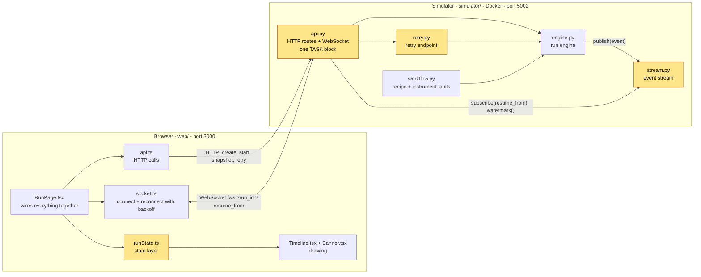

### 2.1 The workflow (a DAG)

Arrows mean "must finish before". Three steps share the liquid handler and two share the incubator, so steps queue for a busy instrument (`step.refused`) as a normal part of a run.

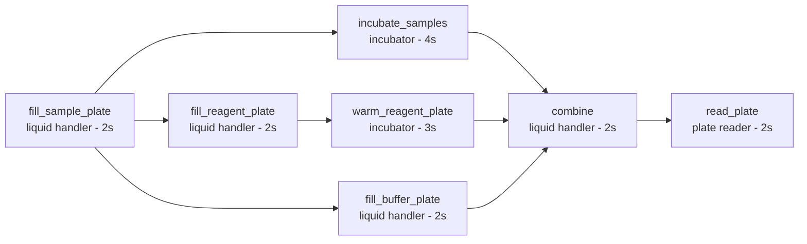

### 2.2 Lifecycle of one step (engine.py)

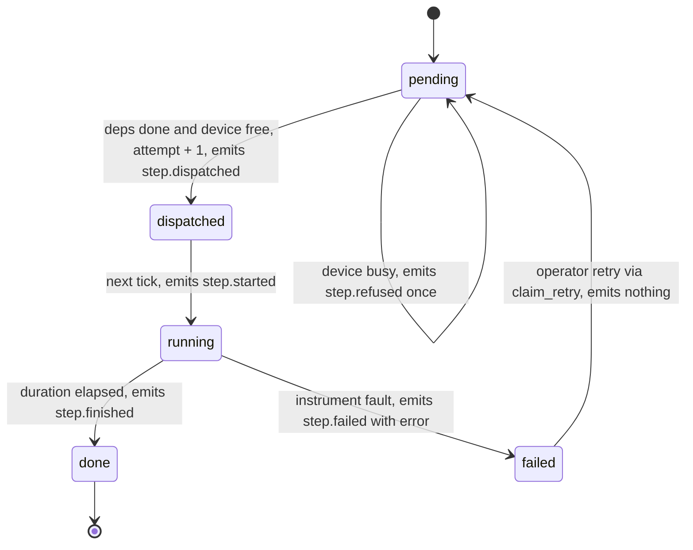

### 2.3 Lifecycle of a run

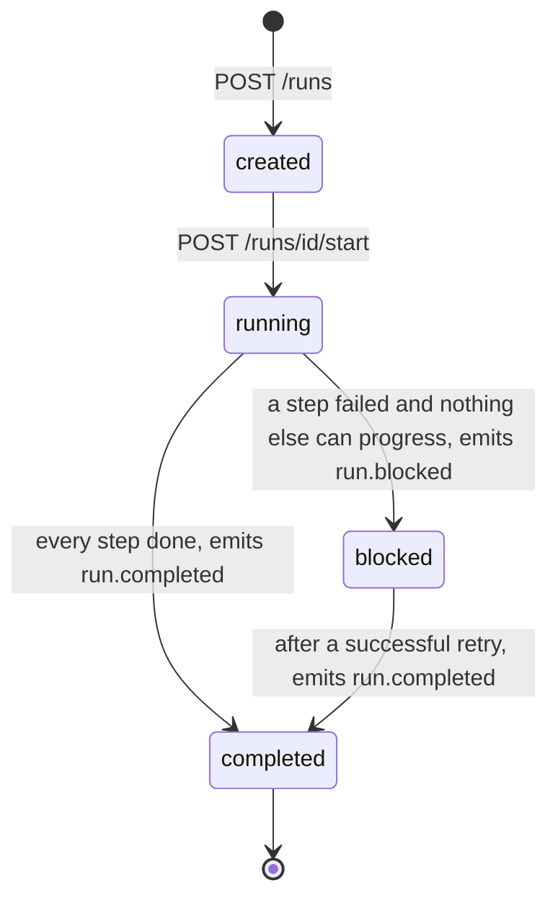

Note: after a retry the run status stays `blocked` until it completes. There is no "unblocked" event.

---

## 3. Current data flow (as-is)

### 3.1 Swimlane: the life of one event

Red = where the chain is broken today.

```mermaid
flowchart LR
  subgraph EN["Engine - engine.py"]
    E1["tick every 100 ms<br/>update steps under run.lock"] --> E2["collect events<br/>seq = 0"]
  end
  subgraph ST["Stream - stream.py"]
    S1["publish(event)<br/>no seq assigned<br/>no history kept"] --> S2{"viewer queue<br/>full?"}
    S2 -->|no| S3["put on each<br/>viewer's queue"]
    S2 -->|yes| S4["event silently dropped<br/>for that viewer"]
  end
  subgraph WS["WebSocket - api.py"]
    W1["take from queue"] --> W2["chaos knobs: may hold back<br/>or send twice"] --> W3["send JSON frame"]
  end
  subgraph SK["Browser socket - socket.ts"]
    C1["parse JSON"] --> C2["onMessage(frame)"]
  end
  subgraph RS["State layer - runState.ts"]
    R1["applyMessage<br/>stub: returns state unchanged"]
  end
  subgraph TL["Screen - Timeline + Banner"]
    V1["selectTracks returns nothing<br/>blank timeline, no banner"]
  end
  E2 --> S1
  S3 --> W1
  W3 --> C1
  C2 --> R1
  R1 --> V1

  classDef broken fill:#fee2e2,stroke:#b91c1c,color:#111
  class E2,S1,S4,R1,V1 broken
```

### 3.2 Swimlane: starting a run and the first load

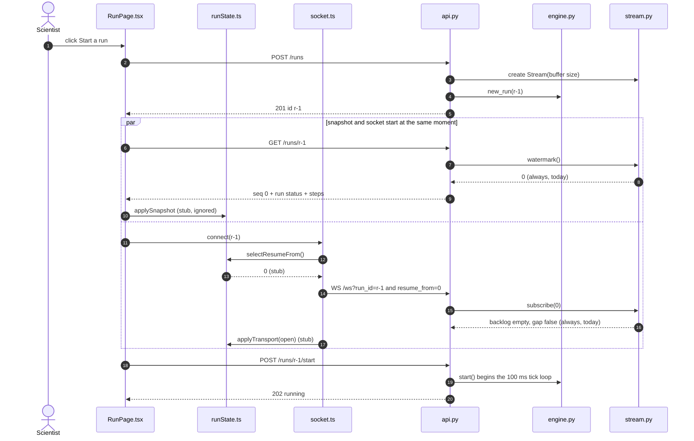

### 3.3 Swimlane: events during a run

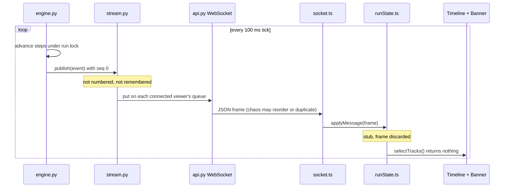

### 3.4 Swimlane: the connection drops (today)

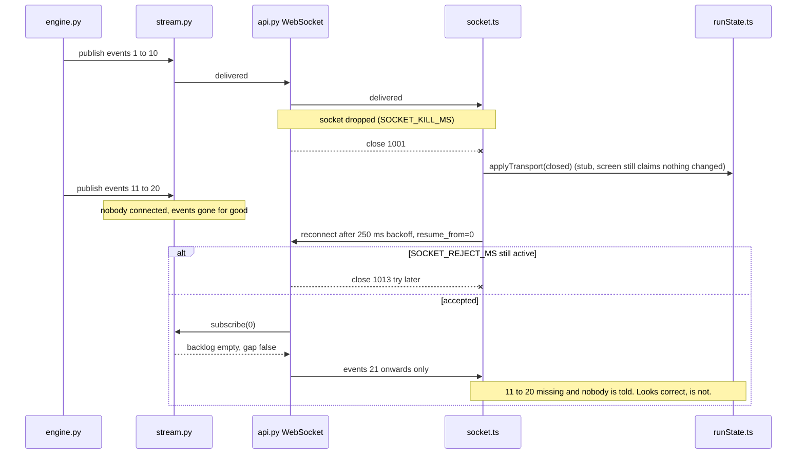

### 3.5 Swimlane: a step fails (today)

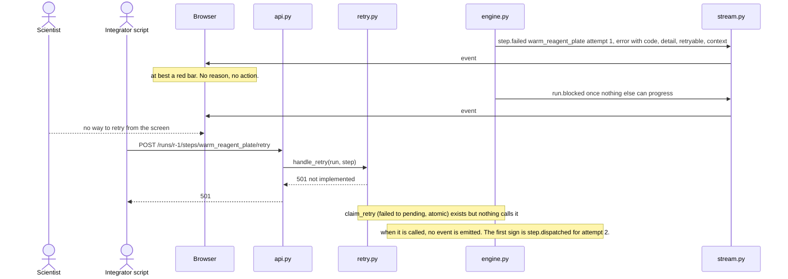

---

## 4. Current user flows (as-is)

### 4.1 Scientist at the bench

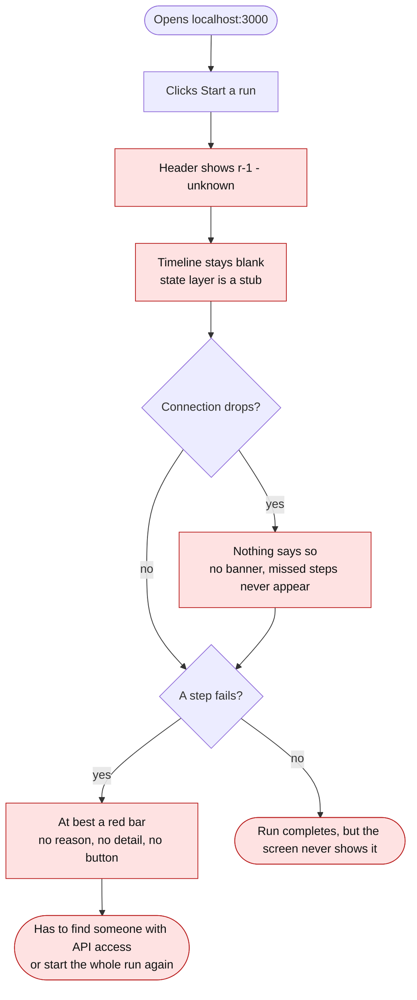

### 4.2 Integrator's script

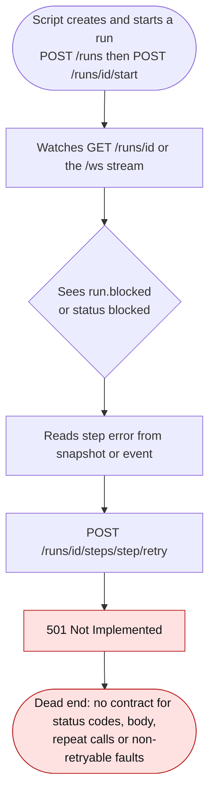

---

## 5. Gap analysis

| # | Gap | Where | Fixed by |
|---|---|---|---|
| G1 | Every event has `seq: 0` | `stream.py` | Problem 1, rung 1 |
| G2 | No history, so nothing can be replayed | `stream.py` | Rung 1 (buffer) + rung 3 |
| G3 | `watermark()` always 0, so the snapshot can't say where it sits | `stream.py` | Rung 1 |
| G4 | A slow viewer silently loses events | `stream.py` | Rung 1 (decision A) |
| G5 | State layer discards everything, so the timeline is blank | `runState.ts` | Rung 2 |
| G6 | Late, duplicate and out-of-order events not handled | `runState.ts` | Rung 2 (decision B) |
| G7 | Reconnect resumes from 0 and loses the window | `runState.ts`, `stream.py` | Rung 3 |
| G8 | Disconnect not shown on screen | `runState.ts` | Rung 3/4 |
| G9 | Unservable resume is silent | `api.py` TASK, `runState.ts` | Rung 4 (decision C) |
| G10 | Retry endpoint returns 501 | `retry.py` | Problem 2 (decision D) |
| G11 | Failure shows only a red bar | new UI | Problem 2 (decisions E to I) |

**Found while reading the code, not stated in the brief:**

- **The snapshot drops retry history.** `GET /runs/id` holds only each step's latest attempt, and `claim_retry` clears the error. A browser that loads after a retry cannot see the first failure or its reason; only the event stream carries it.
- **Snapshot and socket race.** `RunPage` fetches the snapshot and opens the socket at the same time, so events can arrive before the snapshot. The state layer has to accept either order.
- **A retry is silent.** `claim_retry` emits no event. The screen's only confirmation is a later `step.dispatched` for the next attempt, which may itself wait behind a busy instrument (`step.refused`).
- **The run stays `blocked`** while a retried step runs, until `run.completed`.
- **`step.refused` carries the next attempt number** (`attempt + 1`), not the current one.
- **README typo:** `cd ../web` should be `cd web`.

---

## 6. Target solution outline

### 6.1 Changes by component

| Component | Change | Rung / problem |
|---|---|---|
| `stream.py` | Under one lock: assign `seq = last + 1`, append to a fixed-size buffer (oldest evicted), hand to subscribers. `subscribe(resume_from)` computes backlog (`seq > resume_from`) and `gap` (the next needed event is already evicted) and registers the viewer **atomically**, so nothing is missed or doubled between replay and live. Real `watermark()` and `earliest()`. Slow-viewer policy per decision A. | Rung 1, 3 |
| `api.py` (TASK) | On `gap`, tell the client before sending the backlog. Shape per decision C. | Rung 4 |
| `runState.ts` | Attempts keyed by `step + attempt`. Order-proof merge (status only moves forward, times from each event's own `at`). Ignore duplicates and anything at or below the snapshot's `seq`. Resume from the highest `seq` applied. Missing numbers per decision B. Socket closed → `stale`. Gap frame → `gap`, sticky across reconnects. Unknown frames ignored safely. Error and `context` kept intact. | Rung 2, 3, 4 |
| `retry.py` | HTTP contract per decision D, built on `claim_retry`. | Problem 2 |
| New UI | Failure surface per decisions E to I. | Problem 2 |
| `NOTES.md` | Time spent, four questions, feedback on the exercise. | Required |

### 6.2 Target swimlane: reconnect and resume (rung 3)

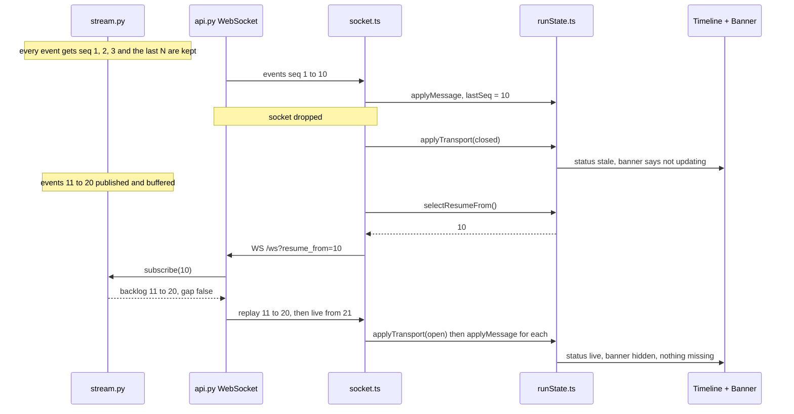

### 6.3 Target swimlane: the gap cannot be served (rung 4) — _draft, depends on decision C_

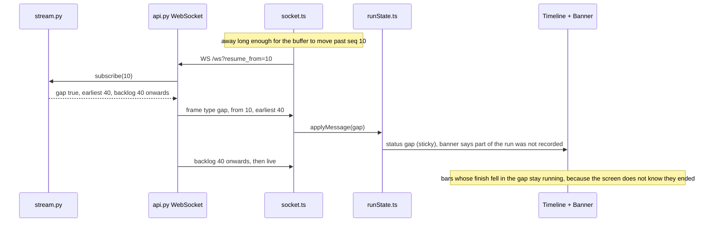

### 6.4 Target swimlane: retry a failed step (problem 2) — _draft, depends on decisions D and G_

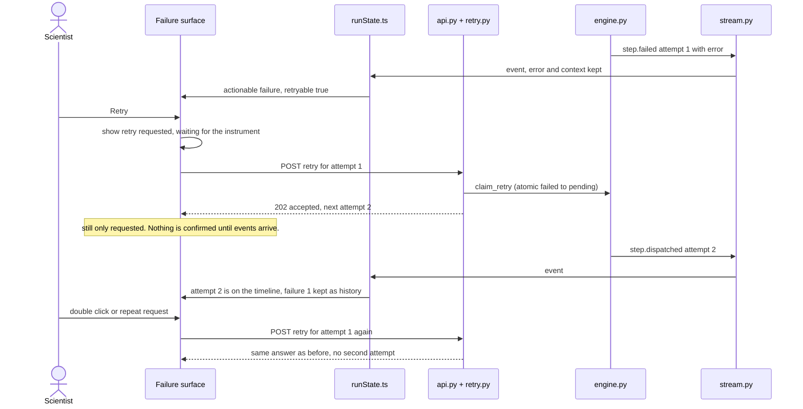

### 6.5 Target user flow: scientist handling a failure — _draft, depends on decisions E to I_

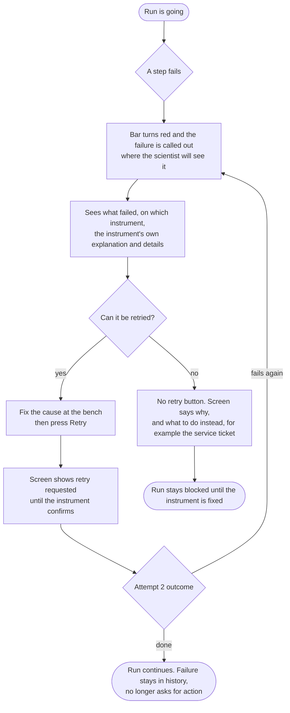

### 6.6 Target user flow: integrator's script — _draft, depends on decision D_

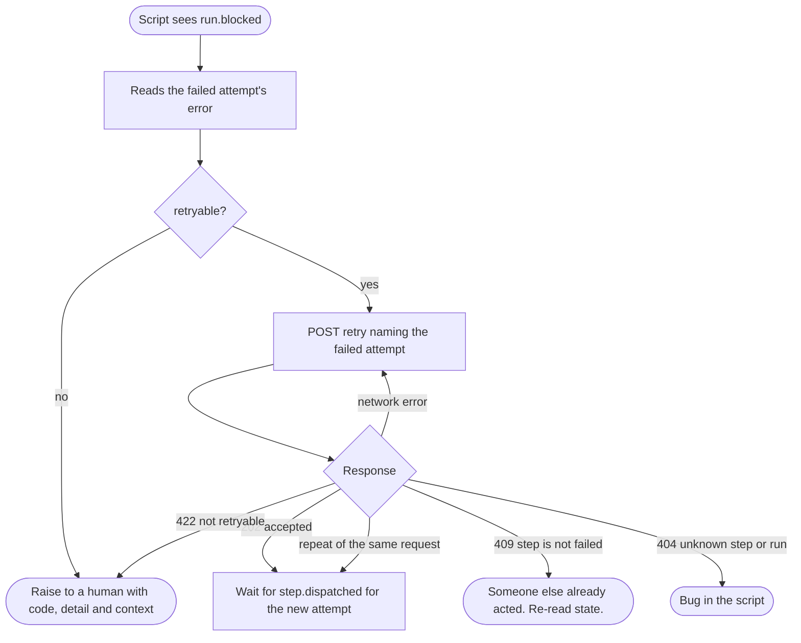

---

## 7. How we check it

| Command | Covers |
|---|---|
| `uv run pytest` | Stream numbering, resume, gap, stalled viewer; retry endpoint works |
| `cd web && pnpm test` | State layer: ordering, duplicates, retries, snapshot watermark, holes, connection honesty |
| `./scripts/acceptance.sh` | Timeline during a clean run (needs simulator + web running) |
| `./scripts/check-disconnect.sh` | Dropped connection is admitted, run still finishes |
| `cd web && pnpm check` | eslint + prettier |

Problem 2 is mostly ungated; we check it by running the three `FAIL_STEP` scenarios and looking at the screen.

---

## 8. Decisions register

All **pending**. Each has three options; the recommendation is listed first.

| ID | Decision | Options (recommended first) | Status |
|---|---|---|---|
| A | Slow viewer whose queue fills (`stream.py`) | 1. Disconnect it; it resumes from the buffer or is told about a gap · 2. Unbounded queue · 3. Drop events and flag a gap inline | Pending |
| B | Out-of-order and missing events (`runState.ts`) | 1. Apply now with an order-proof merge, track holes, stop claiming `live` if a hole persists · 2. Hold back and release in order, write off after N events · 3. Hold back with a timer | Pending |
| C | Unservable resume (`api.py` TASK) | 1. Send a gap frame, then what is still held; sticky banner · 2. Same, plus re-fetch the snapshot to repair current state · 3. Close the socket and reset the client | Pending |
| D | Retry endpoint contract (`retry.py`) | 1. Idempotent per attempt: 202 / same answer on repeat / 409 / 422 / 404 · 2. Simple 202 then 409 · 3. Idempotency-Key header | Pending |
| E | Where failures live on screen | To be framed at spec stage | Open |
| F | Which failures are actionable (failed then retried) | To be framed at spec stage | Open |
| G | What the screen claims between click and stream | To be framed at spec stage | Open |
| H | Showing `context` with unknown keys | To be framed at spec stage | Open |
| I | What to offer when `retryable` is false | To be framed at spec stage | Open |

---

## 9. Delivery order

1. `git init`, commit the untouched starter so the diff shows our work.
2. Settle decisions A to D, write `SPEC.md`.
3. Rung 1 (`stream.py`) → `uv run pytest`.
4. Rung 2 (`runState.ts`) → `pnpm test`.
5. Problem 2: endpoint, then failure surface (decisions E to I first).
6. Rungs 3 and 4 (smaller once 1 and 2 exist) → both scripts.
7. `NOTES.md`, kept as a running log throughout and finished with time to spare.
