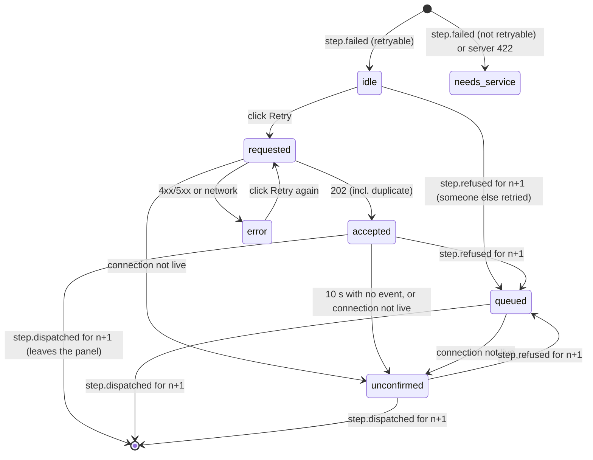

# Design: Lab run monitor take-home

> Spec 2 of 3 · [requirements](requirements.md) → [design](design.md) → [tasks](tasks.md)
> Status: v1.0 · 2026-10-21 · The data-flow and user-flow diagrams are in `docs/SOLUTION_OUTLINE.md` §3–§6; this file covers *how* each piece works.

## 1. What changes, file by file

| File | Change | Requirements |
|---|---|---|
| `simulator/stream.py` | Numbering, replay buffer, atomic subscribe, gap detection, slow-viewer policy | R1–R4 |
| `simulator/api.py` | TASK block sends the gap frame; retry route passes the raw body and returns coded 404s | R4.4, R9 |
| `simulator/retry.py` | `handle_retry` contract; the failed → pending transition moved into a shared `_reset_for_retry` used by `claim_retry` and the handler | R9 |
| `web/src/lib/runState.ts` | The fold, snapshot merge, hole tracking, connection honesty, retry ladder, new selectors | R5–R8, R11, R12 |
| `web/src/lib/api.ts` | `retryStep` sends `{attempt}` and returns a typed result | R9.10, R12 |
| `web/src/pages/RunPage.tsx` | Snapshot first, then connect; renders the new panel and detail | R6.4, R10 |
| `web/src/pages/Timeline.tsx` | Optional `onSelect`/`selected` props so a bar can be clicked. Test ids and `data-*` unchanged | R10.3 |
| `web/src/lib/contextFormat.ts` *(new)* | Label tidying, value formatting, service report text: plain functions | R13, R14.4 |
| `web/src/components/NeedsAttention.tsx`, `FailureCard.tsx`, `InstrumentDetails.tsx`, `AttemptDetail.tsx` *(new)* | The failure surface | R10–R14 |
| `tests/test_spec.py`, `web/tests/runState.spec.test.ts`, `web/tests/contextFormat.test.ts` *(new)* | Tests for every **[new test]** criterion. The provided test files stay untouched | all |

---

## 2. Stream (`stream.py`)

### 2.1 Data held

```text
_seq: int                         last seq handed out (= watermark)
_buf: deque[Event](maxlen=N)      the replay buffer; oldest dropped automatically
_subs: dict[id, _Viewer]          one entry per connected viewer
_Viewer: queue (unbounded asyncio.Queue), over_since: float | None
```

The viewer queue is unbounded at the `asyncio.Queue` level; **we** enforce the 256/512 limits, so we can always fit the final `None` marker in.

### 2.2 `publish(event)`, all under `_lock`

1. `_seq += 1`; `event.seq = _seq`; `_buf.append(event)`.
2. For each viewer: `put_nowait(event)`, then check its size `q`:
   - `q > 512` → disconnect.
   - `q > 256` and `over_since is None` → `over_since = now`.
   - `q > 256` and `now - over_since ≥ 2 s` → disconnect.
   - `q ≤ 256` → `over_since = None`.
   - *Disconnect* means: empty the queue, `put_nowait(None)`, and remove the viewer from `_subs`.
3. After releasing the lock: `await asyncio.sleep(0)`.

**Why the `sleep(0)`** (my call, not in decision A): an uncontended `asyncio.Lock` doesn't hand control to other tasks, so a burst of publishes would never let any reader run. A healthy reader would then hit 512 and be disconnected along with the stalled one. Yielding once per publish lets readers keep up. It waits on nobody, so R3.1 still holds. In real runs the engine publishes about 10 events per 100 ms tick, so the limits are only reached by a viewer that has really stopped reading.

`now` is `asyncio.get_running_loop().time()`.

### 2.3 `subscribe(resume_from)`, all under `_lock`

```text
earliest = _buf[0].seq if _buf else _seq + 1
gap = resume_from > _seq                          # R4.2: beyond anything we published
   or (resume_from < _seq and earliest > resume_from + 1)   # R4.1/R4.3: next one is gone
backlog = [e for e in _buf if e.seq > resume_from]
register viewer
return Subscription(backlog, queue, gap, cancel, earliest=earliest)
```

Doing all of this under the one lock that `publish` also takes means no event can be published between "work out the backlog" and "start receiving live". So nothing is missed and nothing is doubled (R2.3).

`Subscription` gains a field `earliest: int = 0`. It has a default, so the existing constructor calls and tests are unaffected. It is captured at the same instant as the backlog. Calling `stream.earliest()` afterwards could give a different answer if events were published in between.

`watermark()` returns `_seq`. `earliest()` returns `_buf[0].seq` or 0 (under the lock).

| Case | resume_from | held | gap? |
|---|---|---|---|
| Normal resume | 4 | 1–10 | no, backlog 5–10 |
| Up to date | 10 | 1–10 | no, empty backlog |
| Evicted | 1 | 17–20 | **yes** |
| First connect, nothing evicted | 0 | 1–10 | no |
| First connect after eviction | 0 | 5–10 | **yes** (Q1) |
| Ahead of server (restart) | 50 | 1–3 | **yes** (Q1) |
| Nothing published yet | 0 | (none) | no |

### 2.4 Gap frame (`api.py` TASK)

```python
if sub.gap:
    await ws.send_json({"type": "gap", "from": resume_from, "earliest": sub.earliest})
```

Then the existing code sends the backlog and goes live. The frame has no `seq`, so it can't be confused with an event.

---

## 3. State layer (`runState.ts`)

### 3.1 State shape

The exported functions and types stay as they are; `RunState` is ours to shape ("the selectors are the contract").

```ts
interface RunState {
  runId: string | null          // learned from the snapshot or the first event
  runStatus: string
  attempts: Attempt[]           // kept for compatibility, derived from byKey
  byKey: Record<string, Attempt>          // `${stepId}#${attempt}`
  refused: Record<string, true>           // keys a step.refused named (any order)
  seen: Record<number, true>              // seqs applied above `contiguous`
  contiguous: number            // highest seq with nothing missing before it
  maxSeen: number
  floor: number                 // snapshot seq: events ≤ floor are already covered
  socket: 'connecting' | 'open' | 'closed'
  gap: { from: number; earliest: number } | null   // sticky once set
  retries: Record<string, RetryRequest>   // keyed by the failed attempt's key
  lastSeq: number               // = contiguous (old field name kept)
  connection: Connection        // derived on every change, see §3.6
}
```

Plain objects (not `Map`/`Set`) keep it serialisable and easy to compare in tests. Every function returns a new object, since React needs that.

### 3.2 `applyMessage(state, msg)`: deciding what a frame is

1. `msg.type === 'gap'` with numeric `from`/`earliest` → `applyGap`.
2. Has numeric `seq ≥ 1`, string `run_id`, a known `type`, string `at` → `applyEvent`.
3. Anything else → return `state` unchanged (R5.8).

### 3.3 `applyEvent(state, e)`

1. **Drop** if `e.seq ≤ floor`, `seen[e.seq]` or `e.seq ≤ contiguous` (duplicate or already covered), or `runId` is set and `e.run_id !== runId` (R5.6, R5.7, R6.1).
2. Record the seq: `seen[seq] = true`, `maxSeen = max(...)`, then move `contiguous` forward while `seen[contiguous + 1]` (and drop those from `seen`).
3. By type:
   - `step.dispatched` / `step.started` / `step.finished` / `step.failed` → `mergeAttempt(key, patch)`:
     - dispatched: `{status:'dispatched', deviceId}`
     - started: `{status:'running', startedAt: Date.parse(at)}`
     - finished: `{status:'done', endedAt: Date.parse(at)}`
     - failed: `{status:'failed', endedAt: Date.parse(at), error}`
   - `step.refused` → `refused[key] = true`. If the attempt exists, set `refused: true` on it. It doesn't *create* an attempt, because nothing has occupied the instrument yet. When the dispatch arrives later, it picks the flag up from `refused`.
   - `run.blocked` / `run.completed` → `runStatus = maxRank(runStatus, …)`.
4. Recompute `connection` (§3.6).

**`mergeAttempt` is where order stops mattering.** Status takes the higher rank (`dispatched 1 < running 2 < done/failed 3`). Each field is set by exactly one event type, and a field that's already set is never overwritten by null. So applying {started, finished} in either order gives the same attempt. `error` is only ever set by `step.failed` for that same key, so attempt 2 succeeding can't touch attempt 1's error (R5.9).

**Run status rank:** `unknown 0 < created 1 < running 2 < blocked 3 < completed 4`.

**Why the snapshot's seq is safe (R1.4):** the engine changes step state under `run.lock` and only publishes afterwards. The snapshot handler reads `watermark()` *before* taking the lock, so every event at or below that seq has already changed the state it reads. The snapshot may also include a change whose event comes later. Since the merge only moves forward, applying that event again does nothing.

### 3.4 `applySnapshot(state, snap)`

1. `runId = snap.run.id`, `runStatus = maxRank(runStatus, snap.run.status)`.
2. For each step whose status is `dispatched`/`running`/`done`/`failed` and `attempt ≥ 1`: `mergeAttempt(\`${id}#${attempt}\`, {status, deviceId, startedAt, endedAt (done/failed only), error})`. `pending` steps are skipped (R6.3).
3. `floor = max(floor, snap.seq)`; `contiguous = max(contiguous, snap.seq)` and move it forward; drop `seen` entries now covered.

An older snapshot can't move anything backwards, because `mergeAttempt` and `maxRank` only go forward (R6.2, Q2).

**Known blind spot:** the snapshot holds only each step's latest attempt, and `claim_retry` clears `error`. A browser that loads after a retry never sees attempt 1's failure. Written up in NOTES, not fixed.

### 3.5 `applyGap(state, {from, earliest})`

`gap = gap ?? {from, earliest}`. Write off the lost range with `contiguous = max(contiguous, earliest - 1)` and move forward. (`from` is the resume point we sent, which equals `contiguous` at connect time, so there are no older holes to worry about.) Recompute `connection`.

### 3.6 Connection status: one function, worked out after every change

```text
holeOpen = maxSeen > contiguous
        && count(seen keys > contiguous + 1) >= HOLE_TOLERANCE   (10, see O1)

if socket === 'closed'    → stale, note = gap ? "Disconnected. Part of this run was also not recorded."
                                              : default
elif gap                  → gap   (sticky, R4.6)
elif socket === 'connecting' → connecting
elif holeOpen             → stale, note "An update was lost in transit; this view may be incomplete."
else                      → live
lastSeq = contiguous
```

`applyTransport('open'|'closed')` sets `socket` and recomputes.

### 3.7 Selectors

- **`selectResumeFrom`** → `contiguous` (R6.5). Holes are never written off by counting, only by a gap frame, so a reconnect asks again for anything still missing.
- **`selectTracks`** → one track per `DEVICES` entry, in that order, then any device not in `DEVICES` appended (so an unknown instrument's attempts are kept, though the provided Timeline only draws the known lanes; see NOTES). Attempts on a track are sorted by `(startedAt ?? endedAt ?? +∞, stepId, attempt)`, so the order doesn't depend on arrival order. The `refused` flag is read from the `refused` map.
- **`selectFailures(state, now)`** (new, R11/R12): see §4.2.
- **`selectAttempt(state, stepId, attempt)`** (new): one attempt plus `supersededBy` (the next attempt number, if one exists), for the detail view.

### 3.8 An event for a step we've never seen

Nothing checks step ids against the workflow, so it's treated like any other: the attempt is created and drawn on its device's lane. If the device is unknown too, the attempt is kept and shows up in the failure panel, but the provided Timeline has no lane for it.

---

## 4. Problem 2

### 4.1 Retry endpoint (`retry.py`)

Route: `POST /runs/{run_id}/steps/{step_id}/retry`. `api.py` reads the raw body and passes `(run | None, step_id, body: bytes)` to `handle_retry`.

The pinned-attempt check and the retryable check have to sit in the same lock as the claim (the claim clears `error`), so `handle_retry` takes `run.lock` itself and does all three in one critical section. The transition itself (`status = pending`, clear `refused`, times and `error`) lives in `_reset_for_retry(step)`, which both `handle_retry` and the provided `claim_retry` call, so it's written once. *Changed during build:* the spec first had `claim_retry` take an `expected_attempt` argument; the shared helper keeps the provided function's signature and behaviour exactly as they were. Unknown body fields are rejected (400), so a typo like `{"attempts": 1}` can't silently turn into an unpinned retry.

Decision table (inside one `run.lock`):

| Condition | n = pinned attempt (or current, if no body) | Result |
|---|---|---|
| run missing | – | 404 `UNKNOWN_RUN` |
| step missing | – | 404 `UNKNOWN_STEP` |
| body not JSON / `attempt` not a positive int (bools rejected) | – | 400 `INVALID_BODY` |
| status `failed`, `attempt == n`, error not retryable | n | 422 `NOT_RETRYABLE` + `error` |
| status `failed`, `attempt == n`, retryable | n | **claim** → 202 `duplicate:false` |
| pinned, and `attempt > n`, or (`attempt == n` and status `pending`) | n | 202 `duplicate:true` (attempt n has already been retried) |
| anything else | – | 409 `STEP_NOT_FAILED` + `step` |

"`attempt == n` and `pending`" can only mean "claimed, not yet dispatched", because a step that has never run is `pending` with attempt 0.

**202 body:** `{"run_id", "step_id", "retrying_attempt": n, "next_attempt": n+1, "status": <step status now>, "duplicate": bool, "message"}`. `message` is plain English for the screen ("Retry accepted. Attempt 2 will start when incubator-1 is free."); scripts use the other fields. The 409 message tells "already retried, attempt n+1 waiting" apart from "not failed".
**Error body:** `{"code", "message", ...details}`, where details are `step` (409) or `error` (422).

Why 202 and not 200: the retry is *accepted*, not done. The only real confirmation is `step.dispatched` for `next_attempt` on the stream. Without a body, a repeat after success returns 409, because the server can't tell a repeat from a stale click. That's why the browser always pins the attempt.

### 4.2 Retry ladder in `runState.ts` (Q4)

```ts
interface RetryRequest {
  stepId: string; attempt: number
  phase: 'requested' | 'accepted' | 'error'
  requestedAt: number; acceptedAt?: number
  code?: string; message?: string
  notRetryable?: boolean           // server said 422
}
applyRetryRequested(state, stepId, attempt, now): RunState
applyRetryResult(state, stepId, attempt, result: RetryResult, now): RunState
```

`selectFailures(state, now)` returns one `FailureView` per step whose **latest** attempt is `failed` and that has **no `dispatched`-or-later attempt n+1** (R11). Its `phase`:



Precedence when working out the phase: `needs_service` > `unconfirmed` because the connection isn't live (even when queued: the dispatch could not be seen) > `queued` (an event is evidence, so it never times out) > `unconfirmed` because 10 s passed after a 202 > the request's own phase > `idle`. *Refined during build:* the first draft put `queued` above every `unconfirmed`, which contradicted the diagram's `queued → unconfirmed` edge. `unconfirmed` comes from `now` and `connection`, so it's never stored. RunPage already re-renders every 250 ms with a fresh `now`.

The timeline only ever reads `byKey`, which only events change, so a click can never move a bar (R12.7).

### 4.3 Screen layout

```text
┌ header: Lab run monitor · r-1 — blocked · [Start a run] ┐
│ <Banner> (connection)                                    │
│ ┌ Needs attention ─────────────────────────────────────┐ │  only while selectFailures is non-empty
│ │ FailureCard (one per actionable failure)             │ │
│ └──────────────────────────────────────────────────────┘ │
│ <Timeline> bars clickable                                │
│ AttemptDetail for the selected bar (if any)              │
└──────────────────────────────────────────────────────────┘
```

**FailureCard** (retryable: amber; not retryable: rose with a "Needs service" badge), in reading order:

1. Headline: **warm_reagent_plate failed** · incubator-1 · attempt 1 · 15:51:23
2. The instrument's own words, large: "chamber did not reach 37.0C within tolerance"
3. Code, small and monospace: `SETPOINT_NOT_REACHED`
4. Action area:
   - retryable: "Check the instrument, then retry. Completed steps are kept." + **[Retry step]** (`retry-button`) + ladder text (`retry-status`)
   - not retryable: "Retrying won't help: this instrument will fail the same way until it is serviced." · "The run can't finish until this is fixed. Completed steps are kept." · **[Copy report for service]**
5. **Instrument details** (open `<details>`), with **[Copy JSON]**

**InstrumentDetails** renders `context` as a two-column list: tidied label (with the raw key in small grey monospace beside it), then the value. Nested values (Q3) go through a recursive `ContextValue`:

- object → a bordered, lightly shaded box with the same label/value rows inside
- list → a bordered box with numbered rows (`1`, `2`, …), each value rendered recursively
- empty object/list → "(empty)"

**AttemptDetail** (below the timeline, `attempt-detail`): step, attempt, device, status, start/end (or "still running, no end reported"), refused-before-dispatch, and for a failure the same error block, read-only, plus "Superseded by attempt #n" when relevant. Closing it clears the selection.

### 4.4 `contextFormat.ts` (pure, unit-tested)

- `tidyLabel(key)`: strip a known unit suffix → map it to a unit (`_c`→°C, `_s`→s, `_ms`→ms, `_ul`→µL, `_ml`→mL, `_days`→days, `_pct`→%); underscores to spaces; capitalise the first letter; add ` (unit)`. `actual_c` → "Actual (°C)", `door_cycles` → "Door cycles", `volume_ul` → "Volume (µL)".
- `formatScalar(v)`: number → `String(v)`, boolean → Yes/No, null/undefined → "—", string as is.
- `serviceReport(runId, attempt)`: plain text with run, step, attempt, instrument, failed-at (ISO), code, detail, and every context line.

Known nuance for NOTES: Python sends `37.0`, JSON parsing in JS turns it into `37`, so the screen shows "37".

---

## 5. Test plan

| Area | Where | Covers |
|---|---|---|
| Provided gates | `tests/test_stream.py`, `web/tests/runState.replay.test.ts`, both scripts | as tagged **[gate]** |
| Stream extras | `tests/test_spec.py` | 512 hard limit; 2 s grace (fake clock via monkeypatched loop time); resume above watermark → gap; resume 0 after eviction → gap; `earliest` matches backlog; no loss or duplicate across subscribe-while-publishing |
| Gap frame on the wire | `tests/test_spec.py` | small buffer, connect with an old `resume_from` via the ASGI websocket test client → first frame is the gap frame |
| Retry endpoint | `tests/test_spec.py` | every row of §4.1; two concurrent pinned calls → exactly one `duplicate:false` |
| State extras | `web/tests/runState.spec.test.ts` | foreign `run_id` ignored; refused before or after dispatch gives the same result; late snapshot doesn't regress; snapshot `pending` adds no attempt; hole warning clears when the seq arrives; closed-after-gap note; `selectFailures` actionability and every ladder transition, incl. 10 s and someone else's retry; `selectAttempt.supersededBy` |
| Formatting | `web/tests/contextFormat.test.ts` | labels, scalars, service report |
| Problem 2 on screen | manual, three `FAIL_STEP` runs | checklist in tasks.md T6.6 |

---

## 6. Risks and open items

- **O1. Hole tolerance vs. the reorder knob. Decided: 10.** With `REORDER_PCT=30`, a held-back event waits on average ~3 events, and about 1 time in 6 more than 5. So at the agreed tolerance of 5, the "update was lost" warning will flash and then clear during reorder chaos, a false alarm. Options: (1) keep 5 (it does clear itself, and the tests pass); (2) raise it to 10 (false alarms drop to ~3%; the hole test has 17 later events, so it still passes); (3) count *and* time: 5 events and ≥2 s since the hole opened (needs a clock in the reducer). **Chosen: 2 (10).** A real loss is still reported within 10 events (about a second of a run), and the provided test (17 later events) still passes.
- **O2. The reorder knob's held-back list is shared** by every socket and run. An event held when its socket dies can come out on another socket (foreign `run_id`, ignored) and is then lost for good on a live socket, until the next reconnect refills it.
- **O3. Server restart.** The resume point is above the watermark, so we report a gap (honest), but the browser still holds the old run's seen seqs and may ignore the new run's early events. Out of scope; goes in NOTES.
- **O5. A hole near the end of the stream is never reported (found in T5.6). Decided: time backstop + refill.** The tolerance counts *later events*, so a hole near the end never reaches it. Now: `applyTick(state, now)` (fed by RunPage's 250 ms timer) starts a timer for the lowest missing seq; open for `HOLE_TIMEOUT_MS` = 2 s → `stale` with the hole note. RunPage then calls the socket's new `reconnect()` once per missing seq; the resume position stops below the hole, so the server's replay fills it and the warning clears by itself. Verified with `REORDER_PCT=30`: a mid-run loss healed on its own.
- **QA review, loop 1 (independent QA-lead subagent).** No gaps labelled Critical; Osman treated QA-1 and QA-2 as Critical under our own definition and fixed QA-1 to QA-4:
  - QA-1: a failure inside a gap got no card. Now RunPage re-reads the snapshot on every gap frame (`state.gaps` counts them) and merges it forward-only (decision C option 2, previously not built).
  - QA-2: the retry card said "not receiving updates" after any gap or hole warning, with the socket open. `selectFailures` now tests `state.socket`, not the banner status.
  - QA-3: a snapshot taken just before the run started left the header on "created". Any step event now implies at least `running`.
  - QA-4: after a gap, a new hole was never refilled (the banner shows the gap first). `selectOverdueHole` reports it independently, and RunPage reconnects on it.
  - Recorded, not fixed: QA-5 to QA-15 (see docs/WORKLOG.md).
- **O6. The very last event can still be lost unseen (found in T5.6, after O5).** If the *final* event is the one held back, nothing after it reveals a hole, so the page shows every bar done but the run still "running". Seq numbers can't reveal a missing tail; the client needs to learn the stream position some other way (a heartbeat carrying the watermark, or re-reading the snapshot's `seq`). **Decided: not built; written up in NOTES** as the event contract's main gap (a heartbeat frame with the watermark, which would also detect a half-dead connection). Partly a simulator artifact: the reorder knob holds the last event forever, which a network with retransmission would not.
- **O4. Bursts.** Without the `sleep(0)` in §2.2, a burst over 512 events would disconnect healthy viewers too. It only causes a resume, not a loss, but the yield avoids it.
